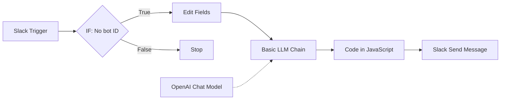

# 🍽️ Slack Recipe Bot

**CAIE Course Program | Social Eagle | Assignment 8 – GenAI Automation**

## Project overview
An AI-powered n8n automation that receives recipe names in Slack and replies in the same channel with a formatted ingredient list and approximate quantities for four people.

## Workflow architecture

## Technologies
- Self-hosted n8n on Hostinger VPS with HTTPS
- Slack API and Event Subscriptions
- OpenAI Chat Model
- JavaScript

## Features
- Automatic recipe requests through Slack
- AI-generated ingredients and approximate quantities
- Default serving size of four people
- Dynamic channel ID mapping
- Slack-friendly message formatting
- IF condition to prevent bot reply loops

## Setup
1. Import `Slack_Recipe_Bot.json` into n8n.
2. Create or select Slack and OpenAI credentials in n8n. Configure the Slack signing secret.
3. Add the Slack bot scopes `channels:read`, `channels:history`, and `chat:write`. Install the app and invite it to a public recipe channel.
4. Select that channel in the Slack Trigger. Disable Socket Mode and enable Event Subscriptions with `message.channels`.
5. Test using the test webhook URL while n8n is listening. Verify and save the URL in Slack.
6. Ensure the IF true branch connects to Edit Fields and the false branch is unconnected. Test bot filtering before publishing.
7. Publish the workflow, replace the Slack Request URL with the production webhook URL, verify and save.
8. Send a recipe name in Slack and check the reply and execution history.

## Demonstration
The live workflow successfully returned a formatted ingredient list for **Paneer Butter Masala** in Slack. Chicken Biryani was used during node testing. The human-message IF branch was tested; verify bot-message rejection and absence of repeated replies before submission.

## Security
Do not commit API keys, bot tokens, signing secrets, private webhook URLs, or pinned personal data. Review the exported workflow and screenshots before publishing. Configure your own credentials after importing. Slack supports one event request URL per app.

## Learning outcomes
Slack API integration, webhook configuration, dynamic data mapping, LLM prompting, JavaScript formatting, conditional routing and deployment of an AI automation.
